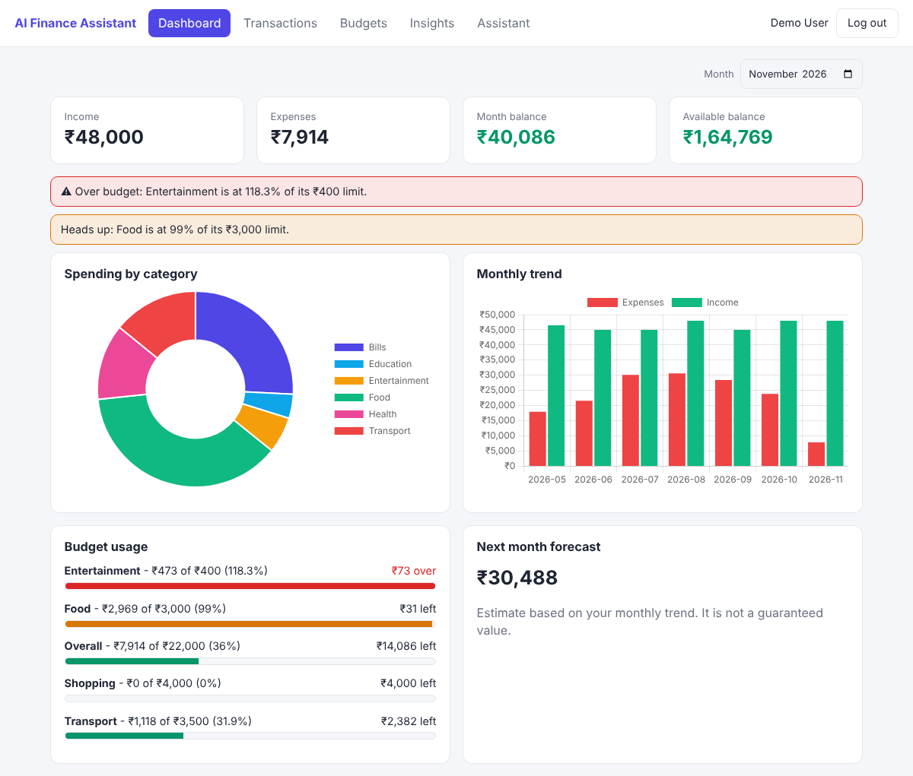
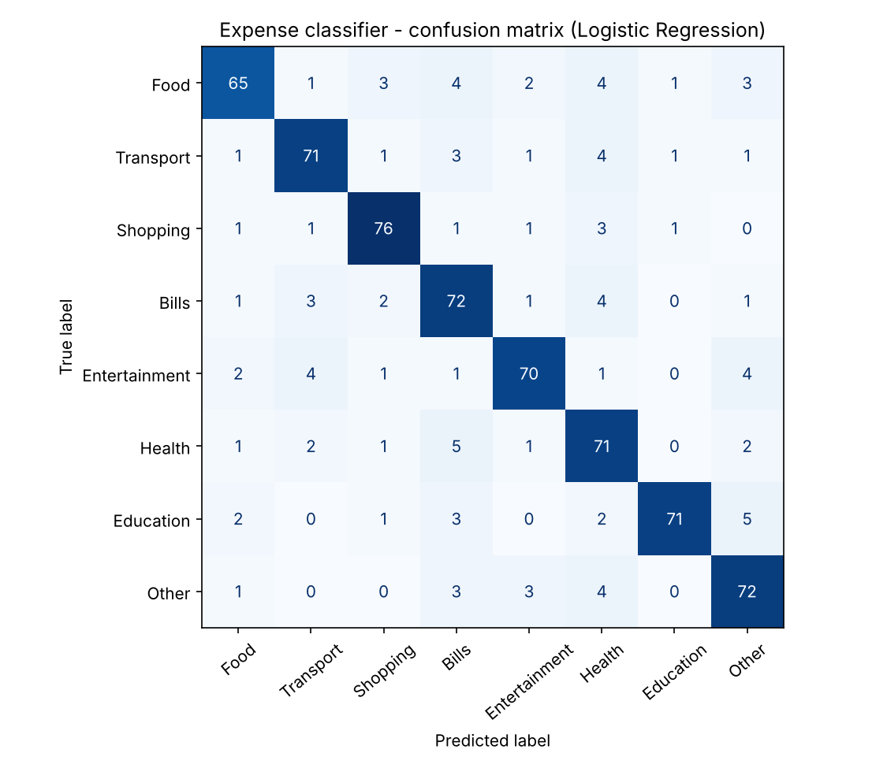
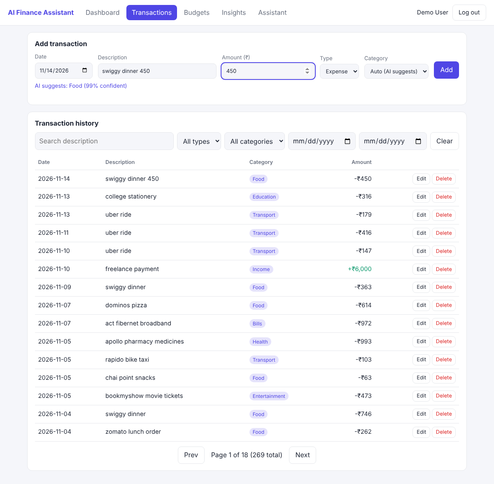
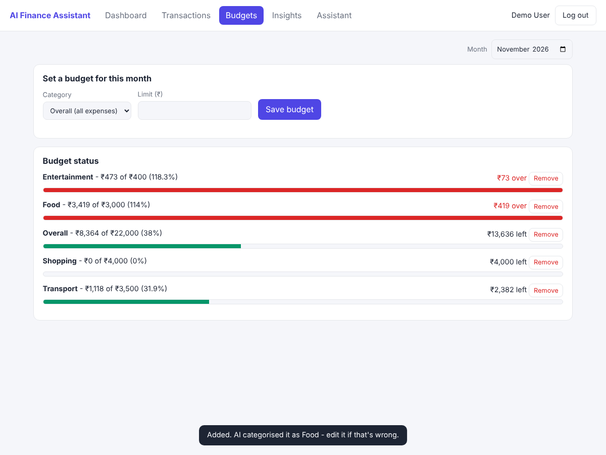
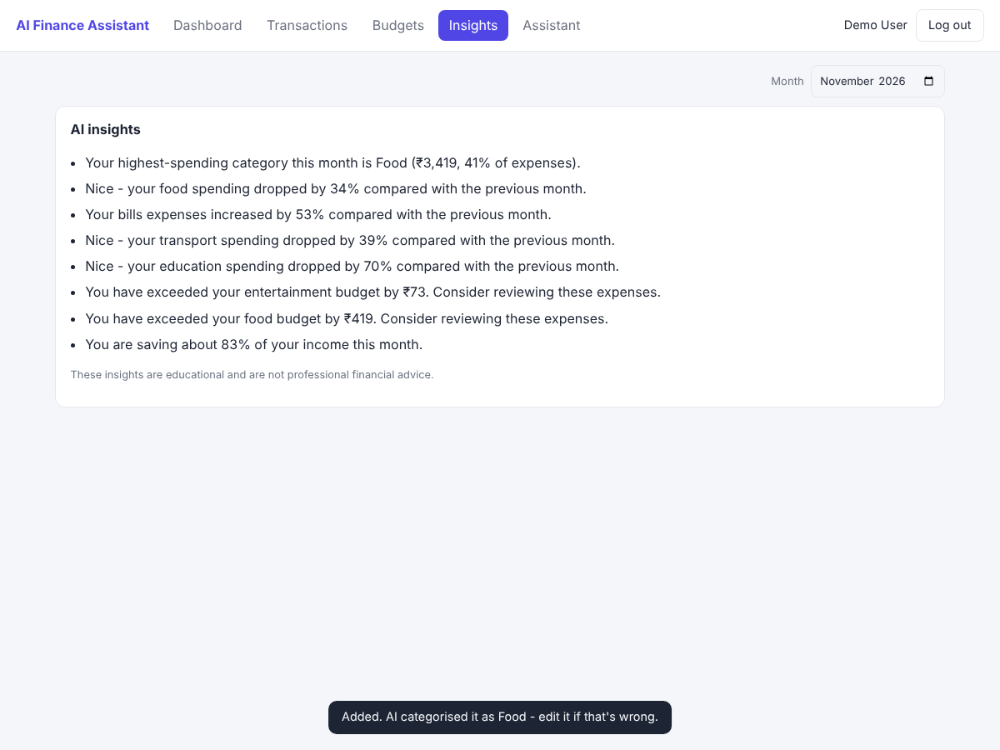
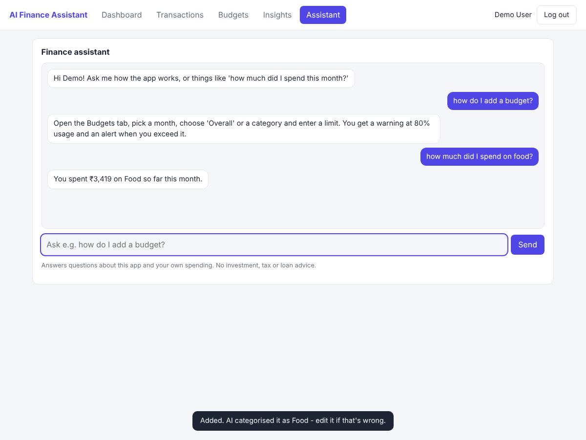

# AI Finance Assistant

A simple web app that helps you track your money. You add your income and expenses, and the app uses **machine learning** to guess the category of each expense (for example, `swiggy dinner 450` becomes **Food**). It also shows charts, keeps your budgets, and gives you simple tips about your spending.

> This is a learning project. The tips it gives are **not** professional financial advice.



---

## Why this project?

Many people (especially students) do not know where their money goes each month. Writing every expense by hand and sorting it into categories is boring, so most people stop doing it.

This app makes it easier:
- You only type a short note, like `uber ride 300`.
- The AI picks the category for you.
- The app shows you where your money went, and warns you when you spend too much.

---

## What can it do?

| Feature | In simple words |
|---|---|
| **Sign up and log in** | Each person has their own account. You can only see your own data. Passwords are stored in a safe, scrambled form. |
| **Add, edit, delete expenses** | Keep a list of all your income and expenses. You can search and filter it by text, type, category, date or amount. |
| **AI category guess** | While you type a description, the app suggests a category and shows how sure it is (for example, "Food, 99% confident"). |
| **Fix the AI** | If the AI is wrong, you change the category yourself. The app remembers your correction. |
| **Budgets** | Set a monthly limit for everything, or for one category like Food. You get a warning at 80% and an alert when you go over. |
| **Dashboard** | See your total income, total expenses, balance, a pie chart of spending by category, and a bar chart for each month. |
| **Next month estimate** | The app guesses how much you may spend next month, based on your past months. |
| **Tips (insights)** | Short messages such as "Your food spending went up 20% compared with last month." |
| **Chat helper** | A small chatbot that answers questions like "how do I add a budget?" or "how much did I spend on food?". |
| **Admin page** | A special admin account can see the users and retrain the AI using the corrections people made. |

---

## How does the AI part work?

**1. Guessing the category**
- The app reads the description you typed, for example `swiggy dinner 450`.
- It cleans the text: small letters only, numbers and symbols removed. So it becomes `swiggy dinner`.
- It turns the words into numbers (this is called **TF-IDF**). It looks at whole words and also at small pieces of words, so a spelling mistake like `swigy` still works.
- A **Logistic Regression** model then picks the most likely category out of 8: Food, Transport, Shopping, Bills, Entertainment, Health, Education, Other.
- The model was trained on a fake (made-up) dataset, so no real bank data or personal data was used.

**2. Guessing next month's spending**
- The app adds up your spending for each past month.
- A **Linear Regression** model draws a straight line through those months and extends it by one month.
- If you have fewer than 3 months of data, the app does not pretend to be smart. It shows a simple average and tells you why.

**3. Learning from mistakes**
- Every time you fix a wrong category, the app saves your correction.
- The admin can press **Retrain model** to train the AI again with those corrections.

---

## How good is the AI?

These numbers are from the test data (data the model had never seen):

- **Category guessing: about 85% correct.** I tried four different methods (Logistic Regression, Naive Bayes, Linear SVM, Random Forest). All gave almost the same result, so I kept Logistic Regression because it is the simplest to explain.
- **Why not 100%?** Some descriptions are impossible to guess, like `upi payment` or `amazon order`. They could be anything. An early version got 100% only because the fake data was too easy, so I made the data more realistic.
- **Next month estimate:** On the fake dataset it is **not** better than a simple average, because fake data has no real trend. This is shown honestly in the report. With real data that goes up or down over time, it works better.



*(The confusion matrix shows which categories the AI mixes up. Dark squares on the diagonal mean correct guesses.)*

---

## Screenshots

| Add an expense (AI suggests a category) | Budgets |
|---|---|
|  |  |

| Tips (insights) | Chat helper |
|---|---|
|  |  |

---

## Tools used

- **Python** and **Flask** for the backend (the part that works behind the scenes)
- **SQLite** for the database (one simple file, no setup needed)
- **scikit-learn**, **pandas**, **NumPy** for machine learning and data
- **HTML, CSS, JavaScript** and **Chart.js** for the pages and charts

---

## How to run it on your computer

You need **Python 3.9 or newer**.

1. **Download** this project and extract the zip (if you downloaded a zip). Open a terminal inside the project folder.
2. **Make a virtual environment** (a clean box for this project's packages):
   ```
   python -m venv .venv
   ```
3. **Turn it on:**
   - Windows: `.venv\Scripts\activate`
   - Mac / Linux: `source .venv/bin/activate`
4. **Install the packages:**
   ```
   pip install -r requirements.txt
   ```
5. **Add demo data** (makes a demo user with about 7 months of sample expenses):
   ```
   python seed_demo.py
   ```
6. **Start the app:**
   ```
   python app.py
   ```
7. Open your browser and go to **http://127.0.0.1:5000**

**Demo logins**

| Who | Email | Password |
|---|---|---|
| Normal user | `demo@example.com` | `demo123` |
| Admin | `admin@example.com` | `admin123` |

You can also click **Register** to make your own account.

**If the page does not open:** port 5000 may be busy. Run this instead and open http://127.0.0.1:5001:
```
python -c "from app import app; app.run(port=5001)"
```

---

## How to run the tests

```
python -m pytest -q
```
You should see `30 passed`. The tests check login, adding and editing expenses, budgets, the dashboard numbers, the chatbot, the admin page, and the AI.

---

## What is inside the project?

```
app.py                  The main Flask app (all pages and API routes)
seed_demo.py            Creates demo users and sample expenses
requirements.txt        List of packages to install
ml/                     Everything about machine learning
  generate_dataset.py     Makes the fake training data
  text.py                 Cleans the description text
  train.py                Trains and tests the AI, saves it
  forecast.py             Next month estimate
models/                 The saved trained model and its test results
data/                   The fake dataset (CSV)
notebooks/              A notebook that explains the training step by step
templates/ static/      The web pages (HTML, CSS, JavaScript, Chart.js)
tests/                  Automatic tests
docs/                   Charts and screenshots
AI_Finance_Assistant_Report.docx   The full project report
```

---

## Main API routes (for developers)

| What you want | Route |
|---|---|
| Sign up / log in / log out | `POST /register`, `POST /login`, `POST /logout` |
| Add or list expenses | `POST /transactions`, `GET /transactions` |
| Edit or delete an expense | `PUT /transactions/<id>`, `DELETE /transactions/<id>` |
| Guess a category | `POST /predict-category` |
| Dashboard numbers | `GET /dashboard?month=YYYY-MM` |
| Budgets | `POST /budgets`, `GET /budgets` |
| Tips | `GET /insights?month=YYYY-MM` |
| Chat helper | `POST /chatbot` |
| Admin only | `GET /admin/users`, `POST /admin/retrain` |

---

## Is it safe?

- Passwords are **hashed** (scrambled) and never saved as plain text.
- Every request checks who you are, so one user can never see another user's data.
- User input is checked on the server, and all text is made safe before it is shown on the page.
- If you ever put this on the internet, set your own `SECRET_KEY`, use HTTPS, and use a real production server instead of `python app.py`.

---

## Limits (things it cannot do)

- The AI was trained on **made-up data**, so on real expenses it may be less accurate.
- New users have little history, so the next month estimate is rough. It is only an estimate.
- Unclear descriptions (like `payment`) are hard to guess. That is why you can correct the category.
- The chatbot only knows a fixed set of questions.
- It does **not** connect to banks, give investment or tax advice, or move money.

---

## Ideas for the future

- Connect to UPI or bank statements
- Read receipts from photos (OCR)
- Add expenses by voice
- Better forecasting that understands seasons (like festival months)
- Warnings for unusual spending
- Savings goals
- A mobile app and online hosting

---

## Made by

**Nikhil Ragala** — built as the major project of an AI internship, based on the *AI Finance Assistant SRS v1.0*.
